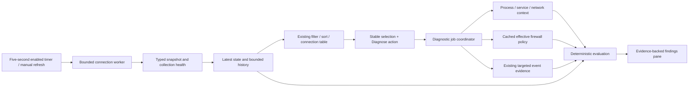

# Diagnostic workbench: proposed architecture

Status: recommendation, not implemented. Date: 2026-11-08. The verified baseline is in [current state](diagnostic-workbench-current-state.md); source/API feasibility is in [gap analysis](diagnostic-workbench-gap-analysis.md). Defaults and budgets in this document are starting design targets to validate, not measured characteristics of the application.

## Responsibility and boundaries

Answer: **What is communicating with this endpoint, what owns that communication, what Windows configuration affects it, and why might communication be failing?**

Keep one Rust desktop executable and the existing Iced connection table. Use ordinary Rust modules before considering reusable crates. A future `lib.rs` can expose pure models/evaluation to tests without creating a multi-crate workspace. Extract a crate only when a second real consumer needs it. No plugin framework, scripting engine, microservices, kernel driver or permanently installed agent is required.

Collectors expose read-only queries and subscription lifecycle operations; they do not expose firewall/service/route mutation methods to the diagnostic engine. Findings suggest checks, not automatic repairs. Targeted provider/event views are allowed; full Event Viewer, rule editing, firewall policy deployment, AD administration, patch management, process killing and service control are excluded. IFC8 is a representative saved expectation, not a hard-coded process-name special case or a promise of Opera protocol expertise.

## Smallest maintainable component layout

Proposed paths are future work; only these documentation files were created during the audit.

| Proposed module | Owns | Must not own | Existing reuse |
| --- | --- | --- | --- |
| `model.rs` | Typed endpoints/process instances, snapshots, availability, evidence references | OS handles or widgets | Replace lossy `SocketDisplay` as authoritative data (`src/main.rs:121`) |
| `collectors/connections.rs` | IP Helper enumeration through a tested adapter | Process policy interpretation | `get_netstat` (`src/main.rs:770`) |
| `collectors/processes.rs`, `services.rs` | Narrow process refresh; selected details; SCM map/config | Choosing one service from shared PID without evidence | Persistent `sysinfo::System` |
| `collectors/firewall.rs`, `network.rs` | Effective policy/filter associations, adapters/profile/route context | Definitive packet verdicts | No existing collector |
| `collectors/events.rs` | Bounded Event Log queries; later WFP subscriptions/capture adapters | Enabling audit/trace policy implicitly | No existing collector |
| `state.rs` | Latest snapshots, diff/history, caches, request IDs, capability health | Platform access or UI layout | `DataState` and refresh flags (`src/main.rs:89,115`) |
| `diagnostics.rs` | Pure deterministic condition checks and finding generation | IO, elevation, settings changes, UI strings containing untrusted markup | Existing filter logic is a separate concern |
| `filter.rs` | Parsed query, documented matching semantics | OS collection | `src/main.rs:793–1126` |
| `ui/` or initially `main.rs` | Messages, table, selection, contextual pane | Synchronous collection | Existing update/view/settings/frame/autocomplete |

Avoid an all-purpose collector trait hierarchy. Shared result envelopes and a few explicit job types are enough. Consider the maintained `windows` bindings for new COM/SCM/Event Log/IP Helper integration, or `windows-sys` where raw calls are appropriate; choose version/features after compatibility review. Do not add both by habit. Existing transitive Windows crates do not make application APIs available automatically. Continue using `sysinfo` where its field coverage, precision and access behavior suffice.

## Data flow and scheduling

Move `get_netstat` out of `App::update` (`src/main.rs:265`), using a dedicated worker owning `System` or a blocking task with explicit single-flight coordination. Calling blocking APIs inside an `async` block still blocks its executor thread. Keep Windows handle/COM apartment ownership inside each appropriate worker. Event query handles are thread-affine per [EvtQuery](https://learn.microsoft.com/en-us/windows/win32/api/winevt/nf-winevt-evtquery); do not move a live query among generic worker threads.

Retain the five-second interval, manual refresh and enable/disable control. Preserve the current startup-off behavior until a deliberate product decision changes it; label interval versus enabled state clearly. At most one connection refresh runs at a time; coalesce repeated requests and skip missed ticks. A stale generation cannot overwrite newer data. A worker error preserves last-good data with age/error status. Track each family/protocol separately so one table failure need not blank every result. Pausing stops scheduled samples, not an already-running synchronous Win32 call; late completion handling must be explicit. Recommended first behavior: finish that sample, show its time, then no more scheduled samples. A separately frozen view must show that collection and display are different states.

Heavy diagnostics are independent, single-flight per selected process/scenario, with a small global concurrency cap (initially two heavy jobs). Selection changes invalidate presentation requests without rewriting original evidence. Use cancellation tokens, deadlines and generation IDs. An in-process synchronous Win32 call may not support forced cancellation: bound concurrency and discard late results; do not claim a timeout killed it. PowerShell subprocesses can be bounded and terminated as owned children. Reserve helper-process isolation only for demonstrated uninterruptible collectors, rather than building it everywhere first.

## Normalized observations

| Record | Required content |
| --- | --- |
| `CollectionEnvelope<T>` | Source/API/version; host/boot identity; start/end UTC; monotonic timing; generation; success/partial/error; coverage; error code; items |
| `Endpoint` | IP family/address, numeric port, IPv6 scope ID when available; wildcard/unknown separate; interface/compartment context if known |
| `ConnectionObservation` | Protocol, local endpoint, optional remote endpoint, TCP state or UDP-bound kind, owner PID(s), process-instance ref, observation interval |
| `ProcessInstance` | Host/boot ID + PID + creation time and precision; optional executable/path provenance, command line, SID/account; per-field availability |
| `ServiceObservation` | Stable service name, display name, status, observed PID/process ref, configured binary command, start type/account; membership and socket-attribution certainty separate |
| `NetworkSnapshot` | Adapters with stable identity and current index/LUID, IP/prefix, DNS servers, network category/profile, routes/counters and sample times |
| `FirewallSnapshot` | Effective profiles/defaults, rule IDs/source, associated filters, unsupported/raw conditions, collection interval, coverage and content version |
| `TrafficScenario` | Selected observation, protocol/direction, concrete local/remote endpoints and interface/profile if known; each value labeled observed/user-supplied/inferred |
| `EventEvidence` | Provider/channel/computer, record ID + log epoch, schema version, UTC event and receive time, raw and normalized tuple/direction/process/application, filter/layer IDs, matching rationale |

Keep machine IDs/report references locally scoped where possible. Monotonic time supports elapsed durations; UTC supports cross-source comparison. Detect clock changes rather than assuming ordering is perfect. “Not collected”, “access denied”, “not supported”, “process exited”, “stale”, “ambiguous”, “collection failed” and “observed absent” are different states. Empty strings or `Unknown` are presentation values, not universal model defaults.

Preserve NT path and normalized DOS path where supplied. Use read-only volume mappings and documented Windows path normalization, case handling and environment-variable expansion; retain original values and failures. Do not equate executable basenames, parse a service binary command as a plain path, or resolve untrusted paths by executing them. Known aliases/reparse paths and inaccessible files can leave program matching Unknown. Service account configuration is not proof of an actual process token or a remote user's identity.

## History and identity lifecycle

Use hash-indexed current observations and bounded change records. For TCP, compare protocol/family/local/remote/process generation excluding state, then record observed state changes. Where OS socket identity is unavailable, identical tuples can represent a replacement connection; label continuity as inferred. For UDP, compare bound endpoints, not invented sessions. Do not deduplicate distinct OS rows solely because their textual tuple matches.

Record first observed, last observed, sampled state changes, disappeared since last successful comparable sample, and collection gaps. Do not fabricate exact open/close times or intermediate transitions. Retain exited-process metadata only within history bounds. Process creation-time unknown means ambiguous continuity: never merge into a later same-PID process automatically. At five-second polling, a connection may be entirely unseen; optional ETW supplements this later with loss accounting and reconciliation to fresh enumeration. WFP net events are diagnostic evidence, not the sole inventory feed.

Initial limits to validate: 15 minutes or 50,000 connection-change records or 32 MiB history, whichever is reached first; 5,000 diagnostic events or 16 MiB event data; at most 10,000 retained exited-process identities, subject also to the history byte budget. Do not retain a full identical snapshot every tick. Keep current inventory separate from historical eviction; if current data exceeds a practical budget, explicitly indicate truncation rather than silently omitting connections. Findings pin compact evidence summaries within their own bounded session budget; expired raw evidence must be labeled expired, not linked misleadingly to reused IDs.

## Firewall matching and evidence model

Use a deterministic, table-tested matcher for an explicitly supported subset of conditions. Each candidate condition returns **Match**, **Mismatch**, or **Unknown**, with evidence/assumptions. AND across conditions: a definite mismatch excludes that candidate for this scenario; any unsupported/unknown condition prevents a complete match. OR across lists is evaluated without hiding unknown alternatives. Maintain a coverage report: “known conditions match” is weaker than “all rule conditions evaluated.”

Retrieve effective policy before evaluating candidates. Retain program/service/package, direction, protocol, local/remote ports and addresses, profile, interface/interface type, action, enabled/enforcement state, security conditions and policy provenance. Evaluate simple ranges/CIDR exactly. Dynamic address/port tokens, AppID/security bypass/IPsec and unavailable interface/service identities return Unknown until supported. Index candidates by direction/protocol/port/profile; still include broad/Any and unknown predicates. Candidate pruning must not hide possible block rules.

Explain ordinary Defender allow/block precedence only within declared coverage. No “first rule wins” ordering. Neither a matching allow candidate nor lack of a visible block guarantees packet passage. There is no proposed documented API that takes this app's incomplete tuple and returns a universal exact WFP decision. Compiled WFP filter enumeration cannot reproduce arbitrary callout behavior, existing state or other network devices. Full evaluation-engine duplication is rejected.

| Finding class | Meaning | Required evidence and permissible wording |
| --- | --- | --- |
| **Observed** | A fact directly returned by a source at a stated time | “TCP listener observed at 0.0.0.0:5001”; “service status is Stopped”; “rule scope contains subnet X” |
| **Inferred** | A deterministic conclusion from observations plus explicit assumptions | “Rule R does not match remote address Y”; “this listener cannot accept traffic to another local port”; “no allow candidate found in collected policy; outcome unconfirmed” |
| **Confirmed Failure** | Direct evidence of the specific failure, with adequate attribution | “WFP blocked this attempted tuple at time T (5157 record N)”; not “the firewall broke IFC8” |

Class is separate from severity and optional confidence. Do not assign numerical confidence without calibration. A 5152 confirms a packet drop; associating it with a selected process/listener can still be inferred or ambiguous. A missing event is not evidence of no block. A 5156 records a permit at its event point, not successful end-to-end communication.

Each finding carries: stable finding/rule ID and evaluator version; classification; severity; subject/scenario; summary and explanation; evidence IDs with source timestamps and policy versions; observed versus user-supplied inputs; assumptions; unsupported conditions and missing capabilities; freshness/coverage; attribution strength; suggested read-only next checks. Rule functions take immutable evidence and emit findings; they cannot query the OS or change settings. Extend through reviewed Rust rules and fixtures first, not executable external scripts. Optional future data-driven checks must be constrained/versioned and unable to execute arbitrary commands.

### Example: IFC8 listener and a rule mismatch

Illustrative fixture, not a finding about the audited endpoint:

1. Snapshot C reports `IFC8.exe`, verified path `C:\Opera\IFC8.exe`, process instance PID 4200/start T0, listening TCP IPv4 `0.0.0.0:5001` at T1. This observes a wildcard bind, not remote connectivity.
2. Network snapshot N reports Domain profile for interface I. Firewall snapshot F contains enabled inbound allow rule R for the same program, TCP/local port 5001/Domain, with remote-address scope `10.20.0.0/24` and service filter Any.
3. The examined scenario is remote `10.30.0.25:53000` to actual local `10.20.0.10:5001` on I. If user-supplied, label it as hypothetical; do not turn `0.0.0.0` into a packet destination.
4. The matcher reports path, direction, protocol, local port and profile Match; remote scope Mismatch; service Any imposes no service restriction even if the executable hosts a service. Finding: **Inferred — R does not cover traffic from 10.30.0.25. Other rules or filtering behavior may determine the result.** Suggested check: inspect other effective candidates or reproduce while observing existing WFP evidence.
5. If a corresponding 5157 at T2 is available, correlate protocol, normalized direction/local/remote tuple, time, application path and process generation where possible. [Filter lookup](https://learn.microsoft.com/en-us/windows/win32/api/fwpmu/nf-fwpmu-fwpmfiltergetbyid0) can retrieve an extant filter by runtime ID. Preserve provider/layer metadata immediately; runtime IDs do not establish a persistent friendly-rule identity. Classify the specific WFP block **Confirmed Failure** only to the attribution strength supported. It does not prove R caused it, that all retries failed, or that a particular service in a shared process originated it.

Direction for an established row is not generally supplied by the current table: do not assume local lower port means inbound. A listener's scenario can explicitly be inbound; actual attempts need event evidence or labeled assumptions. Correlate historical events to historical process identity, never to a reused current PID. Use a configurable narrow time window, retain all plausible matches, and report ambiguity rather than selecting the closest row silently.

## Collection costs, caching and policy consistency

Connection enumeration stays cheap and independent of diagnostic jobs. Refresh only process fields needed for inventory; enrich unique selected processes. Cache identity by process generation, never PID alone. Proposed service status refresh is 10–30 seconds while relevant, with immediate on-demand refresh; service configuration 5 minutes or explicit invalidation. Firewall/network configuration uses lazy cached snapshots (initial TTL 30–60 seconds for active diagnostics) plus manual refresh; investigate change notifications after correctness is established. Idle connection viewing need not launch PowerShell at all.

Start firewall collection with a fixed read-only NetSecurity script emitting versioned structured JSON, executed once per cache refresh with profile loading disabled, no interactive prompts, bounded output, deadline and explicit schema errors. Prefer bulk rule/filter collection and stable association IDs; never join display names. Avoid per-row WMI queries or interpolating process names/paths into commands. Parse JSON fields instead of formatted console output or localized display strings. Policy refresh can race across categories: timestamp and compare relevant rule sets, retry once when inconsistent, otherwise mark partial. A cached result always shows its age and does not retroactively explain an older event as if contemporaneous.

PowerShell may be absent, constrained or blocked by enterprise policy. Show that capability unavailable; do not weaken policy or auto-install modules. A native CIM/COM alternative is justified only when it meets required effective-policy coverage and measured needs. Separate background command execution from the UI; keep original schemas for forward-compatibility without unlimited raw retention.

## Contextual UX

Preserve the table as the main surface and reuse current search, sort, column resize, refresh and settings. Add stable selected-observation state before a side pane; sorting/refiltering must not change the selected identity. A disappeared selection shows “last observed at …” with retained details. At the current 1275-pixel minimum (`src/main.rs:215`), a pane may crowd columns; use a collapsible pane or overlay/details drawer and verify keyboard/DPI behavior before changing the whole layout.

Initial pane sections: connection/time/freshness, owning process, associated service(s), findings summary. “Diagnose This Connection” adds effective firewall candidates, network/profile context, existing block evidence and recent history. Advanced details expand lazily. Show one concise explanation per finding with an expandable condition table and evidence references. Use words/icons and accessible contrast for Observed, Inferred, Confirmed Failure, and Unavailable; do not rely on red/green alone. Separate missing permission from “no matching records.”

Diagnose initially performs only read-only collection. Show what is being collected, completion/cancellation and stale results. For a listener, request or allow entry of peer address/interface when needed, or show which conditions remain unknown. A separate future collection-setup action must disclose machine configuration changes before authorization. DNS lookup or active connection tests are explicit optional actions because they generate network activity; no automatic port scan, payload replay or IFC8 transaction injection.

## Security, retention and cleanup

Run the main viewer unelevated. Show per-collector capability status; do not require elevation for the entire workbench merely to show one privileged field. If a later isolated elevated helper is warranted, use narrow authenticated local IPC, read-only operations and explicit lifetime; no always-on service or arbitrary command endpoint. That helper is deferred pending evidence that direct scoped elevation is inadequate.

Use existing Event Log/WFP evidence first. Event queries are channel/provider/ID/time bounded, with record/byte caps, bookmarks and gaps reported. Copy necessary event values before closing handles. WFP callbacks enqueue compact records without blocking or invoking UI/expensive lookups; count dropped records. Close/unsubscribe/free OS allocations on completion, cancel, shutdown and error. Stop only owned trace sessions with unique IDs; do not terminate someone else's session. Default captures exclude payload, have duration/size limits and restricted temporary files.

Any future setting changes require a distinct authorized collection setup, not permission implied by Diagnose or elevation. Journal exact pre-state and intended changes before applying; reject unsupported restoration scenarios and managed settings that cannot safely be restored. Prefer a separate watchdog for time-limited owned sessions if implementing mutation. On shutdown restore only values still equal to this session's applied values; retain conflict and failure records. On restart, detect orphaned sessions/journals and offer a reviewed recovery action. RAII cannot guarantee global audit/engine settings are restored after a crash or power loss. Never bulk-restore policy over concurrent administrator/GPO changes. If safe recovery cannot be demonstrated, omit automatic setting changes and give administrator-run setup guidance instead.

Reports are explicit, previewable and redacted by default: omit command lines/environment/raw event XML; optionally mask usernames/SIDs, hostnames, IPs, executable directory segments and customer identifiers. Keep redaction consistent across evidence and findings, including embedded strings. Do not hash sensitive values as if hashing guarantees anonymity. No automatic upload, telemetry or AI submission of raw endpoint evidence. Optional AI explanation is later, opt-in, redacted and subordinate to deterministic evidence; it cannot generate Confirmed Failure classifications.
